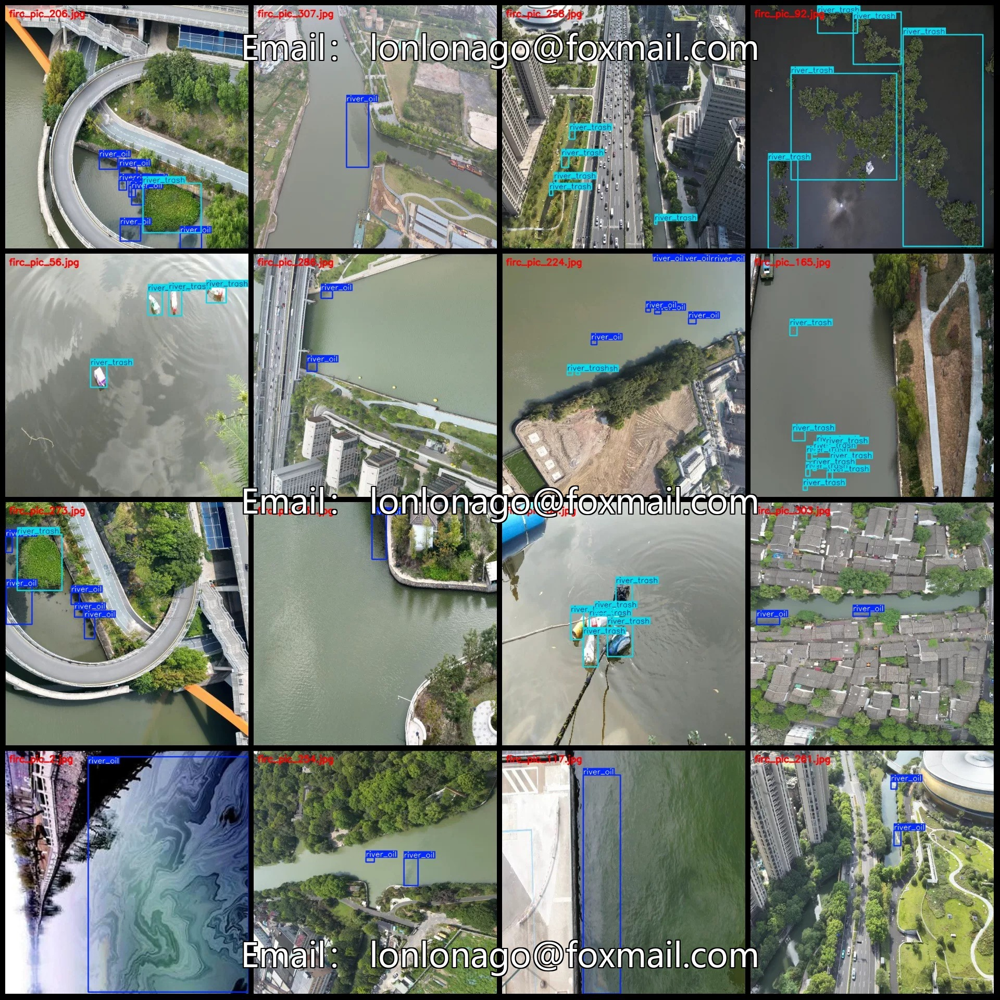
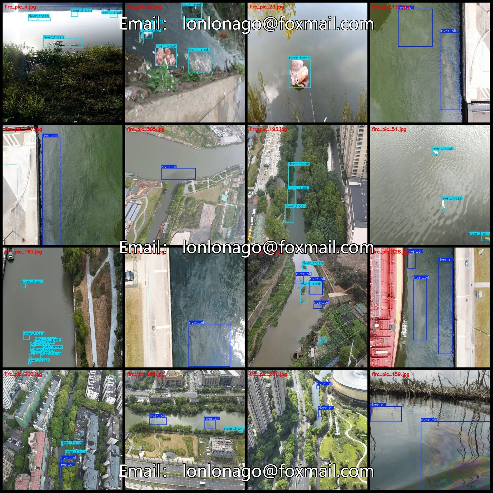
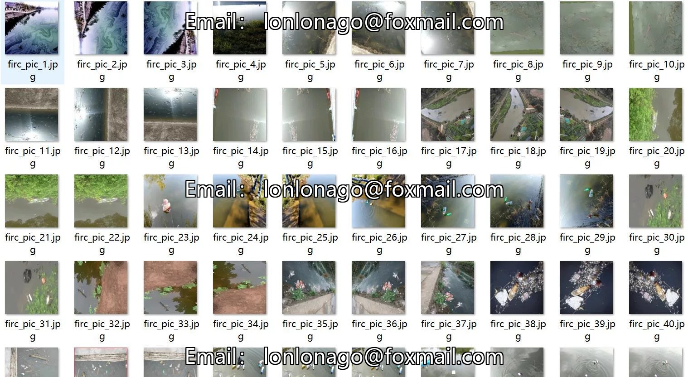
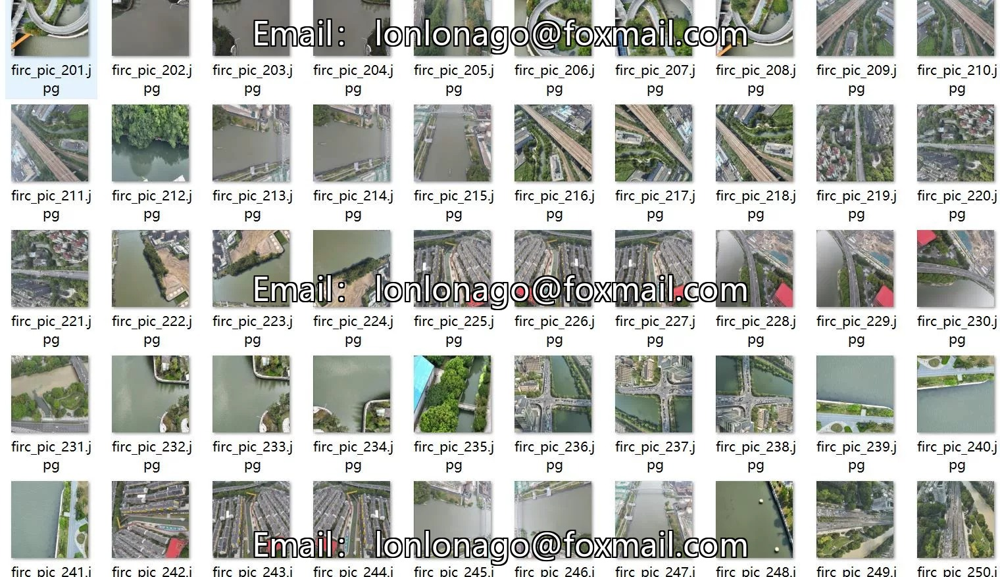
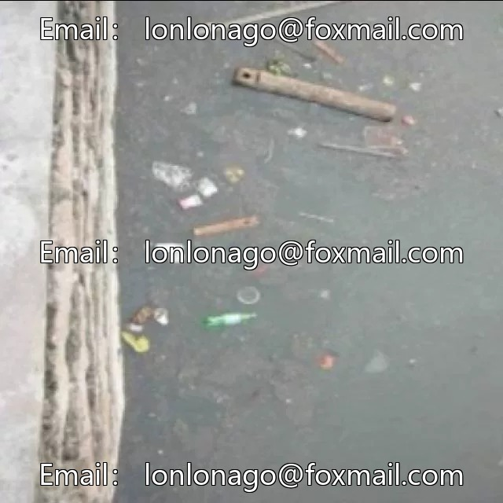

# Drone-view river oil slick and debris detection dataset VOC+YOLO format 310

## Body

Drone-View River Oil and Garbage Detection Dataset - VOC+YOLO Format: 310 Images in 2 Categories

Warm Reminder: Due to the dataset's replicability, please confirm compliance with requirements before purchasing.

Dataset Format: Pascal VOC format + YOLO format (excluding split paths in txt files, only containing jpg images along with corresponding VOC format xml files and yolo format txt files)
Number of Images (Total jpg Files): 310
Number of Annotations (Total xml Files): 310
Number of Annotations (Total txt Files): 310
Number of Annotation Categories: 2

Annotation Category Names (Note that the order of categories in the YOLO format does not correspond to this, but is based on the labels folder's classes.txt): ["river_oil", "river_trash"]
Number of boxes and images per category:
- river_oil: 644 boxes, 190 images
- river_trash: 641 boxes, 188 images
Total number of boxes: 1285
Image resolution: 640x640
Labeling tool used: labelImg
Annotation rules: Draw a rectangle around the category.
Important Note: The dataset does not have separate training, validation, or test sets; you will need to manually split them.

Special : This dataset does not guarantee the accuracy of the trained models or weight files.

## Images

## Payment

Here is a pay link on Stripe ( https://buy.stripe.com/3cs8yP7sY87d0vu9AB ). Please contact me lonlonago@foxmail.com after funding $89, and I will send you a complete data files , thank you!

